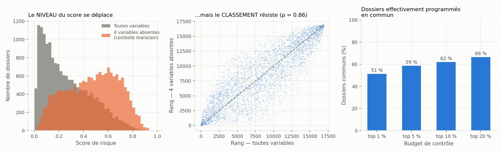

# De la liasse fiscale marocaine aux variables du modèle

Le modèle attend 28 variables comptables nommées selon la nomenclature
**Compustat** (`act`, `ceq`, `sale`, `ppegt`…), héritée du jeu d'entraînement
JAR2020. Un vérificateur de la Direction Régionale des Impôts, lui, dispose de
la **liasse fiscale** déposée par le contribuable : bilan (tableaux n° 1 et 2),
compte de produits et charges (tableau n° 3), établis selon le **Code Général de
Normalisation Comptable**.

Ce document établit la correspondance entre les deux référentiels. C'est la
pièce qui rend le dispositif utilisable au Maroc : sans elle, le modèle reste un
exercice sur données américaines.

**Implémentation :** [`src/liasse_mapping.py`](../src/liasse_mapping.py).
Le tableau ci-dessous est **généré depuis le code** par
[`scripts/generer_tableau_mapping.py`](../scripts/generer_tableau_mapping.py) — code et
documentation ne peuvent donc pas diverger.

---

## 1. Comment lire la colonne « Fidélité »

Un tableau de correspondance qui prétendrait à l'exactitude sur les 28 variables
serait malhonnête. Chaque correspondance porte donc son degré de fidélité :

| Niveau | Signification | Nombre |
|---|---|---|
| 🟢 **directe** | Le poste marocain recouvre exactement la notion Compustat | 14 |
| 🔵 **agrégat** | Reconstruction par somme ou différence de postes exacts de la liasse | 7 |
| 🟠 **approximation** | Le concept diffère ; l'écart est identifié et documenté | 5 |
| ⚪ **indisponible** | Absent de la liasse ; laissé à `NaN`, jamais comblé par un zéro | 2 |

**22 des 28 variables** (🟢 + 🔵 + `pstk` par convention) sont donc
reconstituables à partir de la seule liasse fiscale. Les manquantes sont
détaillées au §3.

---

## 2. Tableau de correspondance

<!-- DEBUT TABLEAU GENERE -->

| # | Variable | Définition Compustat | Poste de la liasse marocaine | Tableau | Comptes CGNC | Fidélité |
|---|---|---|---|---|---|---|
| 1 | `act` | Current Assets — Total | TOTAL II (actif circulant hors trésorerie) + TOTAL III (trésorerie-actif) | Bilan — Actif | 3xxx, 51xx | 🔵 agrégat |
| 2 | `ap` | Accounts Payable — Trade | Fournisseurs et comptes rattachés | Bilan — Passif (dettes du passif circulant) | 4411, 4415 | 🟢 directe |
| 3 | `at` | Assets — Total | TOTAL GÉNÉRAL ACTIF (I + II + III) | Bilan — Actif | classes 2, 3, 5 (actif) | 🟢 directe |
| 4 | `ceq` | Common/Ordinary Equity — Total | TOTAL DES CAPITAUX PROPRES (A) | Bilan — Passif (financement permanent) | 11xx | 🟢 directe |
| 5 | `che` | Cash and Short-Term Investments | TOTAL III (trésorerie-actif) + Titres et valeurs de placement | Bilan — Actif | 51xx, 350x | 🔵 agrégat |
| 6 | `cogs` | Cost of Goods Sold | Achats revendus de marchandises + Achats consommés de matières et fournitures | CPC — charges d'exploitation | 611, 612 | 🔵 agrégat |
| 7 | `csho` | Common Shares Outstanding | Nombre de titres composant le capital social (ETIC, tableau B4) | ETIC — état des informations complémentaires | 1111 | 🟠 approximation |
| 8 | `dlc` | Debt in Current Liabilities | TOTAL V (trésorerie-passif) + part des dettes de financement à moins d'un an | Bilan — Passif | 55xx, 14xx (échéances < 1 an) | 🔵 agrégat |
| 9 | `dltis` | Long-Term Debt Issuance | Augmentation des dettes de financement (ressources stables) | Tableau de financement (tableau n°5) | flux — compte 14xx | 🟠 approximation |
| 10 | `dltt` | Long-Term Debt — Total | Dettes de financement (C) | Bilan — Passif (financement permanent) | 14xx (141 emprunts obligataires, 148 autres dettes) | 🟢 directe |
| 11 | `dp` | Depreciation and Amortization | Dotations d'exploitation aux amortissements et aux provisions | CPC — charges d'exploitation | 619 (6191, 6192, 6193, 6194, 6195, 6196) | 🟠 approximation |
| 12 | `ib` | Income Before Extraordinary Items | Résultat net de l'exercice − Résultat non courant | CPC | résultat (8xxx) | 🟠 approximation |
| 13 | `invt` | Inventories — Total | Stocks (F) | Bilan — Actif (actif circulant) | 31xx | 🟢 directe |
| 14 | `ivao` | Investment and Advances — Other | Immobilisations financières (D) | Bilan — Actif (actif immobilisé) | 24x/25x (prêts immobilisés, titres de participation) | 🟢 directe |
| 15 | `ivst` | Short-Term Investments — Total | Titres et valeurs de placement (H) | Bilan — Actif (actif circulant) | 350x | 🟢 directe |
| 16 | `lct` | Current Liabilities — Total | TOTAL IV (passif circulant) + TOTAL V (trésorerie-passif) | Bilan — Passif | 44xx, 45xx, 55xx | 🔵 agrégat |
| 17 | `lt` | Liabilities — Total | TOTAL GÉNÉRAL PASSIF − Capitaux propres − Capitaux propres assimilés | Bilan — Passif | 14xx, 15xx, 44xx, 45xx, 55xx | 🔵 agrégat |
| 18 | `ni` | Net Income (Loss) | RÉSULTAT NET DE L'EXERCICE (XIII) | CPC — dernière ligne | 1191/1199 | 🟢 directe |
| 19 | `ppegt` | Property, Plant and Equipment — Total (Gross) | Immobilisations corporelles — colonne BRUT | Bilan — Actif (actif immobilisé) | 23xx | 🟢 directe |
| 20 | `pstk` | Preferred/Preference Stock (Capital) — Total | — (sans équivalent) | — | — | ⚪ indisponible |
| 21 | `re` | Retained Earnings | Réserve légale + Autres réserves + Report à nouveau + Résultats nets en instance d'affectation | Bilan — Passif (capitaux propres) | 114, 115, 116, 1169 | 🔵 agrégat |
| 22 | `rect` | Receivables — Total | Créances de l'actif circulant (G) | Bilan — Actif (actif circulant) | 342x (clients), 343x-349x (autres débiteurs) | 🟢 directe |
| 23 | `sale` | Sales/Turnover (Net) | CHIFFRE D'AFFAIRES (ventes de marchandises + ventes de biens et services produits) | CPC — produits d'exploitation | 711, 712 | 🟢 directe |
| 24 | `sstk` | Sale of Common and Preferred Stock | Augmentations de capital, apports (ressources stables) | Tableau de financement (tableau n°5) | flux — comptes 111x, 112x | 🟠 approximation |
| 25 | `txp` | Income Taxes Payable | État — impôts sur les résultats (dette) | Bilan — Passif (dettes du passif circulant) | 4453 | 🟢 directe |
| 26 | `txt` | Income Taxes — Total | IMPÔTS SUR LES RÉSULTATS (XII) | CPC | 670 (6701 IS de l'exercice) | 🟢 directe |
| 27 | `xint` | Interest and Related Expense — Total | Charges d'intérêts | CPC — charges financières | 631 | 🟢 directe |
| 28 | `prcc_f` | Price Close — Annual — Fiscal | — (donnée de marché, hors liasse) | — | — | ⚪ indisponible |

### Notes de correspondance, variable par variable

**`act` — TOTAL II (actif circulant hors trésorerie) + TOTAL III (trésorerie-actif)**  
*🔵 agrégat* — Le CGNC sépare l'actif circulant de la trésorerie-actif, là où la notion américaine de « current assets » englobe les deux. On somme donc les totaux II et III du bilan actif.

**`ap` — Fournisseurs et comptes rattachés**  
*🟢 directe* — Correspondance exacte : dette commerciale d'exploitation.

**`at` — TOTAL GÉNÉRAL ACTIF (I + II + III)**  
*🟢 directe* — Correspondance exacte. Retenir la colonne NET du bilan actif.

**`ceq` — TOTAL DES CAPITAUX PROPRES (A)**  
*🟢 directe* — Les capitaux propres assimilés (B : subventions d'investissement, provisions réglementées) sont volontairement exclus : ils ne sont pas du capital actionnarial, et Compustat les classerait hors `ceq`.

**`che` — TOTAL III (trésorerie-actif) + Titres et valeurs de placement**  
*🔵 agrégat* — « Cash and short-term investments » réunit la trésorerie et les placements liquides, que le CGNC range dans deux rubriques distinctes.

**`cogs` — Achats revendus de marchandises + Achats consommés de matières et fournitures**  
*🔵 agrégat* — Le CPC marocain n'affiche pas de « coût des ventes » : il est reconstruit à partir des deux postes d'achats. Les autres charges externes (613/614) sont exclues, comme le fait Compustat qui les classe en charges opérationnelles hors coût des ventes.

**`csho` — Nombre de titres composant le capital social (ETIC, tableau B4)**  
*🟠 approximation* — Figure dans l'ETIC (tableau des capitaux propres) et non dans le bilan lui-même. À défaut : capital social / valeur nominale du titre. Non renseigné pour la plupart des sociétés non cotées.

**`dlc` — TOTAL V (trésorerie-passif) + part des dettes de financement à moins d'un an**  
*🔵 agrégat* — La trésorerie-passif (crédits d'escompte, crédits de trésorerie, soldes bancaires créditeurs) constitue l'essentiel de la dette à court terme. L'échéancier des dettes de financement figure à l'ETIC (tableau B7) ; s'il n'est pas disponible, la colonne peut être omise.

**`dltis` — Augmentation des dettes de financement (ressources stables)**  
*🟠 approximation* — Variable de FLUX, absente du bilan. Le tableau de financement la fournit, mais il n'est exigible que des entreprises soumises au modèle normal. Laisser vide si indisponible.

**`dltt` — Dettes de financement (C)**  
*🟢 directe* — Correspondance exacte : dettes à plus d'un an d'échéance à l'origine.

**`dp` — Dotations d'exploitation aux amortissements et aux provisions**  
*🟠 approximation* — Le poste marocain agrège amortissements ET provisions, là où `dp` ne vise que les dotations aux amortissements. Si l'ETIC (tableau B) permet d'isoler les seuls amortissements (6191/6192/6193), le faire.

**`ib` — Résultat net de l'exercice − Résultat non courant**  
*🟠 approximation* — `ib` est un résultat APRÈS IMPÔT hors éléments exceptionnels. Le « résultat courant » du CPC ne convient pas : il est AVANT impôt. On retranche donc le résultat non courant du résultat net. L'approximation porte sur l'effet d'impôt attaché au résultat non courant, que le CPC ne permet pas d'isoler.

**`invt` — Stocks (F)**  
*🟢 directe* — Correspondance exacte, colonne NET (après provisions pour dépréciation).

**`ivao` — Immobilisations financières (D)**  
*🟢 directe* — Participations et créances financières à long terme.

**`ivst` — Titres et valeurs de placement (H)**  
*🟢 directe* — Correspondance exacte.

**`lct` — TOTAL IV (passif circulant) + TOTAL V (trésorerie-passif)**  
*🔵 agrégat* — Symétrique du traitement de `act` : la trésorerie-passif, isolée par le CGNC, fait partie des « current liabilities » au sens américain.

**`lt` — TOTAL GÉNÉRAL PASSIF − Capitaux propres − Capitaux propres assimilés**  
*🔵 agrégat* — Total des dettes, obtenu par différence — le bilan marocain n'affiche pas de sous-total « total des dettes ». Le total du passif étant égal au total de l'actif, on part de `total_actif`.

**`ni` — RÉSULTAT NET DE L'EXERCICE (XIII)**  
*🟢 directe* — Correspondance exacte. Doit coïncider avec le poste du bilan passif.

**`ppegt` — Immobilisations corporelles — colonne BRUT**  
*🟢 directe* — ⚠️ Prendre la colonne **BRUT** du bilan actif, pas la colonne NET : `ppegt` est une valeur d'acquisition, avant amortissements. Le bilan marocain affiche les trois colonnes (Brut / Amortissements et provisions / Net), la correspondance est donc directe.

**`pstk` — — (sans équivalent)**  
*⚪ indisponible* — Le CGNC ne prévoit pas de catégorie d'actions de préférence au bilan. La loi 17-95 permet des actions à dividende prioritaire, mais elles sont rarissimes et non isolées comptablement. Valeur nulle en pratique pour la quasi-totalité des contribuables marocains.

**`re` — Réserve légale + Autres réserves + Report à nouveau + Résultats nets en instance d'affectation**  
*🔵 agrégat* — Bénéfices accumulés non distribués. Le report à nouveau peut être négatif (pertes antérieures) : conserver le signe.

**`rect` — Créances de l'actif circulant (G)**  
*🟢 directe* — Poste global des créances, colonne NET. Il inclut les clients et les autres débiteurs, comme `rect` chez Compustat.

**`sale` — CHIFFRE D'AFFAIRES (ventes de marchandises + ventes de biens et services produits)**  
*🟢 directe* — Le CPC affiche explicitement la ligne « Chiffre d'affaires ». Ne pas utiliser le total des produits d'exploitation, qui inclut la variation de stocks et les reprises.

**`sstk` — Augmentations de capital, apports (ressources stables)**  
*🟠 approximation* — Variable de FLUX, comme `dltis`. Disponible dans le tableau de financement du modèle normal. Laisser vide si indisponible.

**`txp` — État — impôts sur les résultats (dette)**  
*🟢 directe* — Impôt dû non encore décaissé. Le détail du poste « État — créditeur » figure à l'ETIC ; si seul le poste agrégé est disponible, la variable peut être laissée vide plutôt que renseignée avec le total « État ».

**`txt` — IMPÔTS SUR LES RÉSULTATS (XII)**  
*🟢 directe* — Charge d'impôt de l'exercice. Variable centrale du dispositif : elle alimente trois des six ratios fiscaux métier (`tax_burden`, `effective_tax_rate`, `tax_to_sales`).

**`xint` — Charges d'intérêts**  
*🟢 directe* — Ne pas retenir le total des charges financières, qui englobe aussi les pertes de change et les dotations financières.

**`prcc_f` — — (donnée de marché, hors liasse)**  
*⚪ indisponible* — Cours de clôture. Disponible pour les ~75 sociétés cotées à la Bourse de Casablanca, inexistant pour l'immense majorité des contribuables relevant d'une direction régionale. Laissé à NaN dans le cas général.

<!-- FIN TABLEAU GENERE -->

---

## 3. Les variables sans équivalent, et pourquoi on ne les invente pas

Quatre variables ne figurent dans aucun tableau de la liasse fiscale.

| Variable | Nature | Où la trouver, le cas échéant |
|---|---|---|
| `prcc_f` | Cours de bourse à la clôture | Bourse de Casablanca — n'existe que pour les sociétés cotées, soit une infime minorité du portefeuille d'une direction régionale |
| `csho` | Nombre de titres composant le capital | ETIC, tableau des capitaux propres ; ou capital social ÷ valeur nominale |
| `dltis` | Augmentation des dettes de financement | Tableau de financement (tableau n° 5), exigible au seul modèle normal |
| `sstk` | Augmentations de capital, apports | Tableau de financement (tableau n° 5) |

`dltis` et `sstk` sont des variables de **flux** : elles décrivent des mouvements
de l'exercice, non des soldes. Le bilan ne les contient pas par construction.

**Ces variables sont laissées à `NaN`, jamais remplies par des zéros.** La
distinction est méthodologiquement décisive. XGBoost traite nativement les
valeurs manquantes : à l'apprentissage, il détermine pour chaque nœud la
direction par défaut des observations dont la valeur est absente. Un `NaN`
signifie donc « information non disponible » et est traité comme tel. Un `0`, à
l'inverse, affirmerait au modèle que l'entreprise n'a réalisé aucune
augmentation de capital et que son action ne vaut rien — deux affirmations
fausses, placées de surcroît à un endroit précis de la distribution
d'entraînement. Combler les trous par des zéros produirait des scores
silencieusement faux.

Cas particulier, `pstk` (actions de préférence) : le CGNC ne prévoit pas cette
catégorie au bilan. La loi 17-95 sur les sociétés anonymes autorise les actions
à dividende prioritaire, mais elles sont rarissimes et non isolées
comptablement. Ici, l'absence n'est pas une lacune de saisie mais une **absence
structurelle** : la valeur correcte est `0`, et le module l'affecte par
convention explicite.

**Effet mesuré :** avec les quatre variables absentes, la couverture d'entrée
s'établit à **85,7 %** (24 des 28 variables renseignées). L'onglet « Liasse
marocaine » du dashboard affiche systématiquement ce taux, ainsi que la liste
des variables vides.

---

## 4. La question des unités — à ne pas négliger

JAR2020 exprime les montants en **millions de dollars américains**. Une liasse
marocaine est déposée en **dirhams** (parfois en milliers de dirhams pour les
grandes entreprises). L'écart d'échelle est de l'ordre de 10<sup>7</sup>.

Cela ne serait sans conséquence que si le modèle n'utilisait que des ratios. Ce
n'est pas le cas : **48 des 54 variables du modèle sont des variables de
niveau** — les 28 variables comptables en log signé, et leurs 20 variations
temporelles. Une entreprise dont le total de bilan vaut « 42 000 000 » au lieu
de « 0,42 » ne se situe pas au même endroit de la distribution d'entraînement,
et les arbres de décision, qui découpent sur des seuils absolus, produisent
alors des scores dépourvus de sens.

La conversion est donc explicite et paramétrée :

```python
df_modele, rapport = mapper_liasse(
    df_liasse,
    unite="dirhams",       # ou "milliers_dirhams", "millions_dirhams"
    mad_par_usd=10.0,      # cours Bank Al-Maghrib à la clôture de l'exercice
    convertir_en_usd=True, # ramène en millions USD, unité d'entraînement
)
```

**Le taux de change doit être renseigné exercice par exercice**, au cours de
référence publié par Bank Al-Maghrib à la date de clôture. La valeur par défaut
de 10,0 est indicative et ne convient qu'à un usage exploratoire.

Les **6 ratios fiscaux métier** (`tax_burden`, `effective_tax_rate`,
`tax_to_sales`, `accruals`, `asset_growth`, `receivables_ratio`) sont en
revanche **invariants d'échelle** : ils restent valides quelle que soit la
devise, puisque numérateur et dénominateur subissent la même transformation.
C'est une propriété rassurante — la part la plus directement interprétable du
modèle, celle qui parle le langage du vérificateur, est aussi celle qui résiste
le mieux au changement de contexte.

> **Une réserve, mise au jour par les tests.** Cette invariance est excellente
> mais **pas exacte**. `add_fiscal_features` protège ses divisions par une garde
> constante ajoutée au dénominateur — par exemple `txp / (|txt| + 10⁻⁶)`. Ce
> terme étant absolu et non relatif, il ne se simplifie pas lors d'un changement
> d'échelle : l'écart résiduel vaut approximativement *garde ÷ dénominateur*.
>
> Sur des montants ordinaires, il est de l'ordre de 10⁻⁶ — négligeable. Mais il
> **croît quand les montants rétrécissent**, et convertir des dirhams en millions
> de dollars les divise par ~10⁷. Pour un contribuable dont la charge d'impôt
> s'élève à 10 000 MAD, le dénominateur converti vaut ~0,001 et l'écart atteint
> 0,1 %. Toujours négligeable, mais la marge n'est pas infinie : à retenir avant
> d'appliquer le dispositif à un portefeuille de très petites entreprises.
>
> La garde ne doit **surtout pas** être rendue relative pour corriger cela : le
> modèle sauvegardé a été entraîné avec cette formule exacte, et la modifier
> décalerait silencieusement toutes les variables. Le test
> `test_effet_de_la_garde_epsilon_reste_negligeable` surveille cet écart.

---

## 5. Format du fichier d'entrée

Un enregistrement par couple **(contribuable, exercice)**. Les en-têtes sont
normalisés automatiquement : majuscules, accents, espaces et tirets sont
tolérés — « Chiffre d'Affaires » et `chiffre_affaires` sont acceptés
indifféremment.

### Colonnes identifiantes — obligatoires

| Colonne | Rôle |
|---|---|
| `identifiant_fiscal` | Identifiant stable du contribuable (IF ou ICE). Joue le rôle de `gvkey` : c'est lui qui permet de comparer un contribuable à lui-même d'un exercice à l'autre. |
| `exercice` | Année fiscale (ex. `2023`). |

### Colonnes descriptives — facultatives

`raison_sociale`, `secteur`, `commune`. Elles n'entrent pas dans le modèle mais
sont recopiées dans la sortie, pour que le vérificateur lise une raison sociale
plutôt qu'un matricule dans le classement de risque.

### Colonnes comptables

Bilan actif : `immobilisations_corporelles_brut`, `immobilisations_financieres`,
`stocks`, `creances_actif_circulant`, `titres_valeurs_placement`,
`total_actif_circulant`, `tresorerie_actif`, `total_actif`.

Bilan passif : `total_capitaux_propres`, `capitaux_propres_assimiles`,
`reserve_legale`, `autres_reserves`, `report_a_nouveau`, `resultats_en_instance`,
`dettes_financement`, `dettes_financement_moins_1an`, `provisions_durables`,
`fournisseurs_comptes_rattaches`, `etat_impots_sur_resultats_dette`,
`total_passif_circulant`, `tresorerie_passif`.

CPC : `chiffre_affaires`, `achats_revendus_marchandises`,
`achats_consommes_matieres`, `dotations_exploitation`, `charges_interets`,
`impots_sur_les_resultats`, `resultat_non_courant`, `resultat_net_exercice`.

Hors liasse (facultatives) : `nombre_actions`, `cours_bourse_cloture`,
`augmentation_dettes_financement`, `augmentation_capital`.

> ⚠️ **Deux pièges de saisie récurrents.**
> 1. `immobilisations_corporelles_brut` doit provenir de la colonne **BRUT** du
>    bilan actif, pas de la colonne Net : `ppegt` est une valeur d'acquisition,
>    avant amortissements.
> 2. `chiffre_affaires` est la ligne « Chiffre d'affaires » du CPC, **pas** le
>    total des produits d'exploitation, qui inclut la variation de stocks de
>    produits et les reprises sur provisions.

### Profondeur d'historique

Fournir **au moins 3 exercices consécutifs par contribuable**. Les 20 variables
de trajectoire comparent un contribuable à lui-même 1 ou 2 exercices plus tôt :
avec un seul exercice, elles sont toutes absentes et le modèle ne score plus que
sur des niveaux absolus — il perd exactement ce qui fait sa valeur ajoutée sur
une analyse de ratios classique.

---

## 6. Contrôles automatiques avant scoring

`verifier_liasse()` exécute quatre contrôles sur le fichier d'entrée. Ils
portent sur la **qualité de l'extraction**, et ne constituent en aucun cas des
indices de fraude.

| Contrôle | Nature | Ce qu'il révèle en général |
|---|---|---|
| Présence et complétude de `identifiant_fiscal` / `exercice` | bloquant | Export incomplet |
| Doublons (contribuable, exercice) | bloquant | Jointure mal faite — fausserait le calcul des variations annuelles |
| Équilibre actif = passif à 1 % près | avertissement | Poste oublié, ou colonnes Brut/Net confondues |
| Profondeur d'historique < 2 exercices pour plus de la moitié des contribuables | avertissement | Variables de trajectoire majoritairement indisponibles |

---

## 7. Chaîne complète, de la liasse au classement de risque

```python
from src.liasse_mapping import lire_liasse, verifier_liasse, mapper_liasse
from src.inference import score_with_diagnostics

# 1. Lecture et normalisation des en-têtes
df_liasse = lire_liasse("exports_dgi/liasses_2021_2023.csv")

# 2. Contrôles de cohérence comptable
diagnostic = verifier_liasse(df_liasse)
if not diagnostic["scorable"]:
    raise SystemExit("\n".join(diagnostic["anomalies"]))

# 3. Correspondance CGNC → Compustat + mise à l'échelle
df_modele, rapport = mapper_liasse(df_liasse, unite="dirhams", mad_par_usd=9.85)
print(f"Couverture : {rapport['taux_couverture_global_pct']} % — "
      f"variables absentes : {rapport['variables_vides']}")

# 4. Scoring
resultat = score_with_diagnostics(df_modele)
classement = resultat["scored"]   # trié par risque décroissant
```

Un fichier d'exemple au format attendu est fourni :
[`dashboard/exemple_liasse_marocaine.csv`](../dashboard/exemple_liasse_marocaine.csv)
— 8 entreprises fictives de la région de Tétouan, 3 exercices chacune.

> **Ces données sont entièrement fictives.** Elles ont été générées pour
> démontrer que la chaîne fonctionne de bout en bout et pour servir de gabarit
> de saisie. Elles ne proviennent d'aucun contribuable réel et les scores
> obtenus n'ont **aucune valeur d'analyse**.

---

## 8. Ces quatre absences invalident-elles le dispositif ? — test de robustesse

La question n'est pas rhétorique. L'analyse SHAP d'un dossier marocain fait
apparaître `prcc_f` et `csho` **parmi les plus forts contributeurs au score**,
alors même qu'ils sont vides : le modèle les route vers la branche par défaut
apprise à l'entraînement, ce qui déplace le score. Il fallait donc mesurer
l'effet plutôt que le supposer.

**Protocole.** Scorer deux fois les mêmes observations JAR2020 hors échantillon
d'entraînement (exercices 2012-2014, 16 904 lignes) : une fois complètes, une
fois avec les 4 variables forcées à `NaN` — c'est-à-dire dans la situation
marocaine exacte. Script reproductible :
[`scripts/robustesse_variables_absentes.py`](../scripts/robustesse_variables_absentes.py).



### Résultat 1 — le niveau du score est fortement déplacé

| | Toutes variables | 4 variables absentes |
|---|---|---|
| Score moyen | 0,264 | **0,471** |

Décalage de **+0,21**, soit près du double. C'est considérable, et cela confirme
par l'expérience ce que le §5 de [`01_cadrage_methodologique.md`](01_cadrage_methodologique.md)
énonce en principe : **le score absolu n'a aucune signification en soi.** Tout
seuil fixe calibré sur des données complètes (« signaler au-dessus de 0,5 »)
serait inopérant sur des liasses marocaines et déclencherait un signalement
quasi général. Le dispositif doit fonctionner en **rang**, jamais en seuil
absolu.

### Résultat 2 — le classement, lui, résiste

| Mesure | Valeur |
|---|---|
| Corrélation de Spearman | **0,865** |
| Tau de Kendall | 0,679 |

Les quatre variables manquant à *toutes* les lignes, leur effet est largement
commun et s'annule en grande partie au classement. La hiérarchie des dossiers
est conservée pour l'essentiel.

### Résultat 3 — la capacité de détection n'est pas dégradée

| Budget de contrôle | Fraudes captées, toutes variables | Fraudes captées, 4 absentes | Dossiers programmés en commun |
|---|---|---|---|
| top 1 % | 0,0 % | 2,9 % | 51 % |
| top 5 % | 8,8 % | 8,8 % | 59 % |
| top 10 % | 17,6 % | 17,6 % | 62 % |
| top 20 % | 47,1 % | 41,2 % | 66 % |

AUC-ROC : 0,714 → 0,712. Aucun effondrement. Les écarts de rappel, dans un sens
comme dans l'autre, portent sur 34 fraudes étiquetées seulement et relèvent du
bruit d'échantillonnage — il ne faut pas en tirer que retirer des variables
*améliore* le modèle.

### Résultat 4 — la réserve à énoncer

La dernière colonne est celle qui doit être citée en soutenance : à budget de
contrôle fixé, **les deux configurations ne programment que 51 à 66 % des mêmes
dossiers**. La qualité globale du ciblage est préservée, mais l'identité des
contribuables retenus change sensiblement. Autrement dit : la méthode se
transpose, la liste de travail nominative, non — elle devra être régénérée
après réentraînement sur données marocaines.

### Ce qu'il faut en retenir

1. Les quatre absences **ne sont pas rédhibitoires** : le classement et la
   capacité de détection survivent.
2. Le dispositif doit s'utiliser **exclusivement en rang** (top *k* %), jamais
   par seuil absolu sur le score.
3. Le réentraînement sur données marocaines devra **retirer purement et
   simplement ces quatre variables** du jeu plutôt que de les laisser vides :
   le modèle cesserait alors de leur consacrer de la capacité prédictive et
   récupérerait le décalage de niveau observé ici.

---

## 9. Prolongement : validation sur des sociétés marocaines réelles

Le mémoire gagnerait à une illustration sur données authentiques. Les sociétés
cotées à la **Bourse de Casablanca** publient leurs états financiers annuels,
diffusés par l'**AMMC** — ce sont les seules données comptables marocaines
publiques, détaillées et pluriannuelles.

Démarche suggérée : retenir 5 à 10 sociétés de secteurs contrastés, saisir leurs
états financiers sur 3 à 5 exercices selon le gabarit du §5, appliquer le
mapping et scorer.

**Ce que cette illustration démontrerait :** que la correspondance fonctionne
sur des liasses réelles, que les 6 ratios fiscaux prennent des valeurs
plausibles, et que le classement produit est lisible par un vérificateur.

**Ce qu'elle ne démontrerait pas :** la capacité du modèle à détecter la fraude
au Maroc. Aucune de ces sociétés n'est étiquetée : sans vérité terrain, un
score élevé n'est qu'un score élevé. Ce point doit être écrit noir sur blanc à
côté de tout tableau de résultats issu de cette illustration — c'est
exactement le genre de raccourci qu'un jury cherchera.
