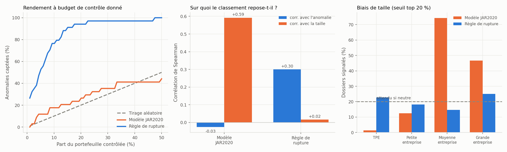

# Le modèle JAR2020 se transfère-t-il au contexte marocain ?

**Réponse : non, pas en l'état.** Appliqué tel quel à un portefeuille marocain,
le modèle ne classe pas par anomalie mais **par taille d'entreprise**.

C'est le résultat central du volet marocain de ce travail. Il n'était pas
attendu, il a été obtenu en testant plutôt qu'en supposant, et il vaut mieux le
présenter soi-même qu'attendre qu'un jury le découvre.

---

## 1. Le protocole

Un portefeuille simulé de la DRI de Tétouan a été construit
([`scripts/generer_jeu_test_marocain.py`](../scripts/generer_jeu_test_marocain.py)) :
**220 contribuables × 4 exercices = 880 liasses**, 14 secteurs représentatifs de
la région, 4 classes de taille — de la TPE à la grande entreprise.

18 contribuables (34 lignes, soit 3,9 %) portent une **anomalie plantée**,
construite à partir des schémas que recherche un vérificateur : minoration du
chiffre d'affaires, majoration des charges, créances fictives, stocks
surévalués, taux d'imposition anormalement bas, accruals élevés, rupture de
trajectoire. L'anomalie n'apparaît jamais au premier exercice : le contribuable
dispose toujours d'un historique propre auquel se comparer.

Deux dispositifs ont été évalués sur ce même portefeuille :

| Dispositif | Nature |
|---|---|
| **Modèle JAR2020** | XGBoost entraîné sur 146 045 états financiers d'entreprises américaines cotées, appliqué via la correspondance CGNC → Compustat |
| **Règle de rupture** | Aucun apprentissage. Compare chaque contribuable à lui-même d'un exercice à l'autre sur 8 ratios invariants d'échelle ([`src/regle_rupture.py`](../src/regle_rupture.py)) |

---

## 2. Le résultat



### Sur quoi chaque dispositif fonde-t-il son classement ?

| Corrélation de Spearman du score avec… | Modèle JAR2020 | Règle de rupture |
|---|---|---|
| **l'anomalie effective** (ce qu'on veut détecter) | **−0,03** | **+0,30** |
| **la taille du contribuable** (ce qu'on ne veut pas) | **+0,59** | **+0,02** |

Le modèle appris est **sans lien avec l'anomalie** et **fortement corrélé à la
taille**. Il ordonne le portefeuille du plus gros au plus petit.

### Rendement à budget de contrôle

| Budget | Modèle JAR2020 | Règle de rupture | Tirage aléatoire |
|---|---|---|---|
| top 1 % | 0,0 % | **26,5 %** | 1 % |
| top 5 % | 11,8 % | **52,9 %** | 5 % |
| top 10 % | 17,6 % | **76,5 %** | 10 % |
| top 20 % | 23,5 % | **94,1 %** | 20 % |

| | AUC-PR | AUC-ROC |
|---|---|---|
| Modèle JAR2020 | 0,0475 | **0,4604** |
| Règle de rupture | 0,5488 | 0,9459 |
| Référence hasard | 0,0386 | 0,5000 |

**Une AUC-ROC de 0,46 est inférieure au hasard.** Sur ce portefeuille, le modèle
appris ne fait pas seulement « moins bien qu'espéré » : il n'apporte rien.

### Le biais de taille, chiffré

Taux de signalement au seuil du top 20 % — une méthode neutre signalerait 20 %
de chaque strate :

| Classe de taille | Modèle JAR2020 | Règle de rupture |
|---|---|---|
| TPE | **1,3 %** | 22,7 % |
| Petite entreprise | 12,5 % | 18,1 % |
| Moyenne entreprise | **74,3 %** | 14,6 % |
| Grande entreprise | 46,7 % | 25,0 % |
| **Écart maximal** | **73,0 points** | **10,4 points** |

Le modèle signale une moyenne entreprise sur quatre exercices, et laisse passer
99 % des TPE. Ce n'est pas un ciblage : c'est un tri par chiffre d'affaires.

---

## 3. L'explication

Elle est structurelle, et vérifiable sur les données.

**JAR2020 ne contient que des sociétés américaines cotées.** Leur total de bilan
médian avoisine **105 millions de dollars**. Le portefeuille d'une direction
régionale marocaine, converti dans la même unité, a un total de bilan médian
d'environ **1 million de dollars** — soit un facteur 100.

Les contribuables marocains se massent donc dans la **queue basse extrême** de
la distribution d'entraînement, autour du 5<sup>e</sup> percentile de JAR2020,
là où le modèle a vu très peu d'exemples. Et comme **48 de ses 54 variables sont
des variables de niveau** — les 28 postes comptables en log signé et leurs 20
variations — les arbres de décision, qui découpent sur des seuils absolus, n'ont
guère d'autre choix que de séparer les dossiers par ordre de grandeur.

Autrement dit : **le modèle n'a pas appris à détecter la fraude en général, il a
appris à détecter la fraude chez les grandes sociétés cotées américaines.**
Appliqué ailleurs, il transporte surtout la notion de taille.

> **Ce constat ne dépend pas de la façon dont les anomalies ont été plantées.**
> Il découle de l'écart entre les deux distributions, mesurable indépendamment
> de toute étiquette. C'est ce qui en fait un résultat solide.

---

## 4. La règle de rupture intra-contribuable

Puisque le problème vient des variables de niveau et de la comparaison à une
population étrangère, l'alternative consiste à ne retenir que des grandeurs
**invariantes d'échelle** et à comparer chaque contribuable **à lui-même**.

C'est ce que fait [`src/regle_rupture.py`](../src/regle_rupture.py). Elle suit
huit indicateurs d'un exercice à l'autre :

| Indicateur | Ce qu'une rupture suggère d'examiner |
|---|---|
| Marge brute | Minoration du chiffre d'affaires, ou majoration des achats |
| Taux effectif d'imposition | Charges non justifiées, reports déficitaires contestables |
| Charge d'impôt / CA | Complète le précédent quand le résultat avoisine zéro |
| Créances / CA | Ventes constatées non encaissées, clients fictifs |
| Stocks / CA | Surévaluation d'inventaire, décalage de résultat |
| Accruals | Résultat reposant sur des écritures plutôt que sur des flux |
| Rotation de l'actif | CA déclaré en décalage avec l'appareil productif |
| Fournisseurs / achats | Achats fictifs, ou achats sans facture |

Le score agrège les écarts relatifs à l'exercice précédent, écrêtés pour qu'un
seul indicateur qui déraille n'écrase pas les autres — on cherche une rupture
**simultanée sur plusieurs ratios**.

**Trois propriétés qui comptent en contexte administratif :**

1. **Aucun apprentissage.** Rien n'est ajusté sur des données : la règle est
   utilisable immédiatement, sans jeu étiqueté.
2. **Explication exacte, non approximée.** Contrairement à SHAP, l'explication
   *est* le calcul. `expliquer_rupture()` renvoie les indicateurs rompus, leur
   écart, et ce qu'il faut aller examiner. Une alerte discutable est une alerte
   utilisable.
3. **Neutre en taille.** Corrélation de +0,02 avec le total de bilan.

---

## 5. Honnêteté sur ce que vaut chaque résultat

Les deux conclusions de ce document n'ont **pas le même statut épistémique**, et
le mémoire doit le dire.

| Conclusion | Statut | Pourquoi |
|---|---|---|
| Le modèle JAR2020 classe par taille et ne transfère pas | 🟢 **Solide** | Découle de l'écart entre distributions, mesurable sans étiquettes. Indépendant de la façon dont les anomalies ont été plantées. |
| La règle de rupture capte 53 % des anomalies dans le top 5 % | 🟠 **Partiellement circulaire** | Les anomalies ont été plantées **sous forme de distorsions de ratios**. Qu'une règle de détection de distorsions de ratios les retrouve n'a rien de surprenant. |

Ce que le second résultat établit réellement :

- la chaîne de traitement **transmet correctement le signal** (correspondance
  CGNC, conversion d'échelle, reconstruction des variables de trajectoire) ;
- le signal, quand il existe, est **localisé dans les grandeurs invariantes
  d'échelle et dans la trajectoire intra-contribuable** — pas dans les niveaux
  absolus.

Ce qu'il n'établit pas : que la règle détecterait de la fraude fiscale réelle.
Cela supposerait des dossiers authentiques et une vérité terrain issue de
vérifications définitives — précisément ce que l'article 246 du CGI rend
inaccessible.

---

## 6. Conséquences pour le mémoire

**À écrire dans la conclusion, en ces termes :**

> Le transfert direct d'un modèle entraîné sur données américaines cotées vers
> un portefeuille fiscal marocain **ne fonctionne pas**. L'écart de taille entre
> les deux populations est tel que le modèle, dont 48 des 54 variables sont des
> variables de niveau, reproduit essentiellement un tri par ordre de grandeur.
> Ce constat, obtenu expérimentalement, constitue en lui-même un résultat : il
> délimite précisément ce qui est transposable — la méthode, la correspondance
> des variables, le protocole de validation — et ce qui ne l'est pas — les
> coefficients appris.

**Trois recommandations qui en découlent :**

1. **Ne pas déployer le modèle JAR2020 tel quel.** Sur un portefeuille de
   direction régionale, il concentrerait le contrôle sur les grandes entreprises
   et laisserait passer la quasi-totalité des TPE — un biais juridiquement et
   politiquement intenable, indépendamment même de son inefficacité.

2. **Réentraîner sur données marocaines**, en :
   - retirant les 4 variables absentes de la liasse
     (cf. [`02_mapping_liasse_fiscale.md`](02_mapping_liasse_fiscale.md) §8) ;
   - **normalisant les variables de niveau par strate de taille et de secteur**,
     ou en les remplaçant par des ratios — c'est la correction que ce résultat
     impose ;
   - conservant les variables de trajectoire, qui sont la partie la plus
     transposable du dispositif.

3. **Utiliser la règle de rupture comme point de départ opérationnel et comme
   étalon.** Elle ne requiert aucun jeu étiqueté, elle est explicable de bout en
   bout, et tout modèle appris ultérieurement devra faire la preuve qu'il fait
   mieux qu'elle. Un modèle qui ne battrait pas une règle transparente ne
   justifierait pas sa complexité.

---

## 7. Reproduire

```bash
python scripts/generer_jeu_test_marocain.py    # portefeuille + clé de correction
python scripts/evaluer_jeu_test_marocain.py    # évaluation comparée
```

Sorties : `reports/evaluation_jeu_test_marocain.csv` et
`reports/figures/07_evaluation_jeu_test_marocain.png`.

Le jeu de données est régénérable à l'identique (graine fixée). Voir
[`05_guide_de_test.md`](05_guide_de_test.md) pour le parcours de test complet.

> **Rappel.** Toutes les données de ce portefeuille sont **fictives**. Aucune
> entreprise, aucun identifiant fiscal, aucun montant ne correspond à une
> réalité. Les données de l'administration sont couvertes par le secret
> professionnel (article 246 du CGI).
